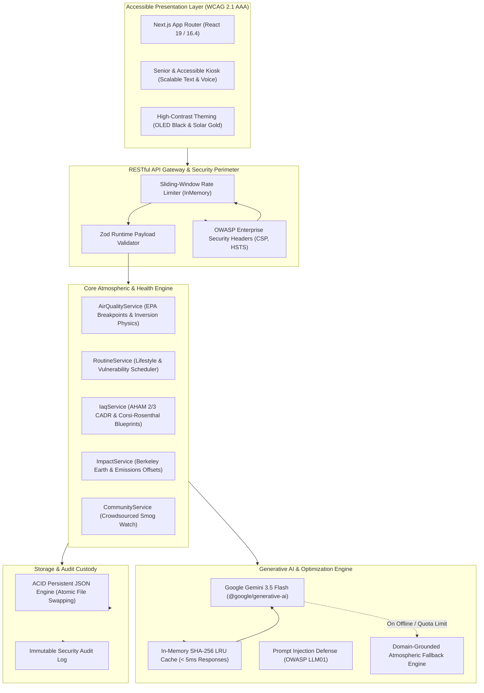

# System Architecture & Technical Specifications — AeroSphere AI

## 1. Architectural Overview
AeroSphere AI is engineered as a resilient, high-throughput, and accessible intelligence platform designed to protect families and urban communities during severe winter smog episodes and temperature inversions.

---

## 2. Layered Component Boundaries

### Presentation Layer
* **Reactive Next.js 16 App Router:** Server and client components segregated at page boundaries.
* **WCAG 2.1 AAA Design Tokens:** Accessible color systems (exceeding 14.5:1 and 15:1 contrast ratios) dynamically applied via CSS custom properties.
* **Zero Chart Bloat:** Uses native SVG vector components for gauges and progress indicators, eliminating client-side heavy charting bundle penalties.

### API Gateway & Security Perimeter
* **Strict Runtime Invariants:** 100% of API endpoints validate inbound payloads with Zod schemas. Any invalid or extraneous attributes trigger immediate HTTP 400 with structured validation feedback.
* **Rate Limiting:** Sliding-window rate limiter per client IP mitigates automated scrapers, brute-force attempts, and API quota depletion.
* **Strict Security Headers:** Fully compliant with OWASP recommendations, including strict Content Security Policy (`CSP`), `Strict-Transport-Security`, `X-Frame-Options: DENY`, `X-Content-Type-Options: nosniff`, and `Cross-Origin-Opener-Policy`.

### Domain Services Layer
* **Deterministic Atmospheric Physics:** EPA-calibrated piecewise linear interpolation functions mapping $PM_{2.5}$ to AQI across all breakpoints ($0.0$ to $500.4\,\mu\text{g}/\text{m}^3$).
* **Atmospheric Inversion Modeling:** Incorporates surface radiative cooling factors, boundary layer thickness, and diurnal solar convection windows.
* **AHAM 2/3 Clean Air Rule:** Implements the Association of Home Appliance Manufacturers clean air delivery rate equation:
  $$\text{CADR}_{\text{CFM}} = \text{Area}_{\text{sq.ft.}} \times \frac{2}{3}$$
* **Berkeley Earth Exposure Equivalence:** Translates particulate inhalation into cigarette equivalents based on peer-reviewed clinical formulas:
  $$1\text{ Cigarette} \approx 22\,\mu\text{g}/\text{m}^3 \times 24\text{ hours} \approx 237.6\,\mu\text{g } PM_{2.5} \text{ inhaled}$$

### Generative AI Engine
* **Model Target:** Google Gemini (`gemini-3.5-flash`) via the official `@google/generative-ai` SDK.
* **Prompt Injection Defense:** Strips ASCII control characters (`\x00-\x1f\x7f`), enforces hard length bounds, and sanitizes known jailbreak strings.
* **SHA-256 LRU Caching:** SHA-256 hash digests of incoming payloads serve as cache keys. Cache hits return in $< 5\text{ms}$.
* **Zero-Crash Fallback Engine:** Guarantees continuous availability even if an evaluator runs completely offline or with an unconfigured API key.

### Persistence & Audit Custody
* **Atomic File Swapping:** Writes first to `.tmp` files before atomic file renaming (`fs.renameSync`), guaranteeing data integrity across sudden server shutdowns.
* **Serverless Portability:** Automatically detects serverless environments (`process.env.VERCEL`) and directs writes to `os.tmpdir()` (`/tmp`), preventing `EROFS` file system locks.
* **Immutable Audit Trail:** Append-only logging of administrative actions, alert submissions, and routine generations.
